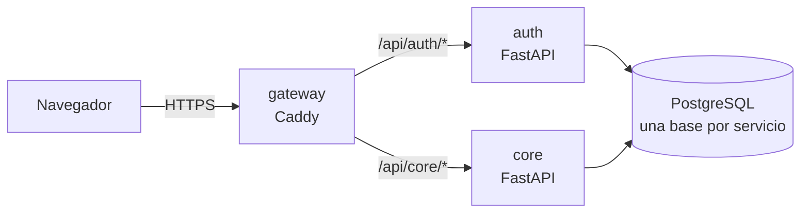

# Sistema de almacén, pedidos y despachos

[](https://github.com/Jos3san/sistema-almacen/actions/workflows/ci.yml)

Sistema web a medida para una librería: catálogo, stock en varias ubicaciones, pedidos de vendedores (desde el celular), despachos y nota de venta. No incluye facturación electrónica, que el negocio resuelve con otro sistema.

Es también un **proyecto de portafolio** construido por capas con un ciclo DevOps completo: diseño documentado, decisiones de arquitectura (ADR), contenedores, integración continua, seguridad automatizada y despliegue en la nube.

> Repositorio público con **datos ficticios**: no contiene información real del negocio.

## Arquitectura (MVP)



- **core**: catálogo, stock (kardex de solo inserciones), pedidos con reserva de stock y despachos.
- **auth**: usuarios, perfiles y permisos; firma JWT RS256 que cada servicio valida con la clave pública.
- **gateway**: única puerta de entrada, cabeceras de seguridad y HTTPS automático.

Detalle en [docs/06-diseno-tecnico.md](docs/06-diseno-tecnico.md) y en las [decisiones de arquitectura](docs/adr/).

## Tecnologías

| Área | Herramientas |
| --- | --- |
| Backend | Python 3.13, FastAPI, SQLAlchemy 2, Pydantic, Alembic, uv |
| Base de datos | PostgreSQL 18 |
| Pruebas y calidad | pytest, Testcontainers (PostgreSQL real), Ruff |
| Contenedores | Docker (multi-stage, usuario no root), Docker Compose, Caddy |
| CI/CD | GitHub Actions, Dependabot, secret scanning |
| Frontend (en camino) | React, TypeScript, Vite, Tailwind |

## Levantarlo en local

Requisitos: Docker Desktop.

```bash
cp infra/.env.example infra/.env        # y cambia la contraseña
docker compose -f infra/compose.yaml up -d --build
docker compose -f infra/compose.yaml ps # esperar (healthy)
```

Luego abre <http://localhost/api/core/docs>. Más comandos en [docs/codigo/infra.md](docs/codigo/infra.md).

## Estado

| Capa | Estado |
| --- | --- |
| 0. Preparación: Git, GitHub, API inicial | ✅ |
| 1. Base técnica: Docker, Compose, gateway, CI, logs, migraciones | 🚧 en curso |
| 2–7. Auth, catálogo, stock, pedidos, despachos, producción | ⏳ |

Plan completo en [docs/04-arquitectura-y-roadmap.md](docs/04-arquitectura-y-roadmap.md) y backlog en [docs/07-backlog.md](docs/07-backlog.md).

## Documentación

| Documento | Contenido |
| --- | --- |
| [00 Ciclo de vida](docs/00-ciclo-de-vida.md) | Cómo se trabaja: flujo, Definition of Done, entornos |
| [01–05](docs/) | Alcance, requerimientos, modelo de datos y reglas, arquitectura, casos de uso |
| [06 Diseño técnico](docs/06-diseno-tecnico.md) | C4, seguridad (OWASP Top 10), principios de código, permisos |
| [07 Backlog](docs/07-backlog.md) | Historias por semana |
| [08 Glosario](docs/08-glosario.md) | Términos y siglas |
| [docs/codigo/](docs/codigo/) | Guía en español de cada servicio |

La documentación está en español; el código, la API y los commits, en inglés.
