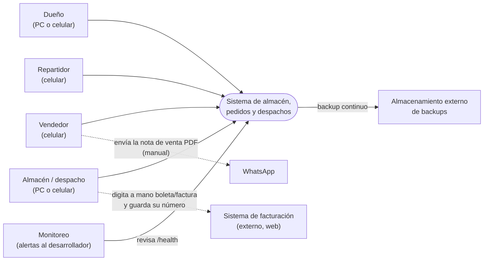
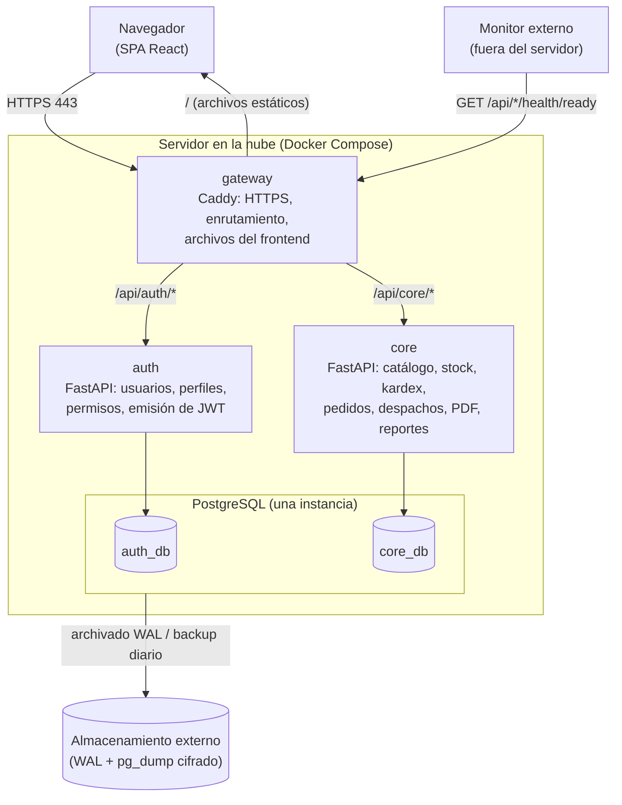
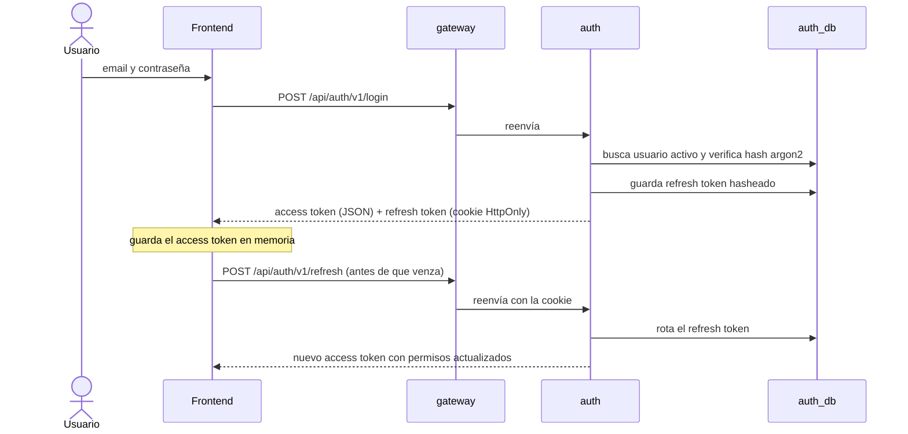
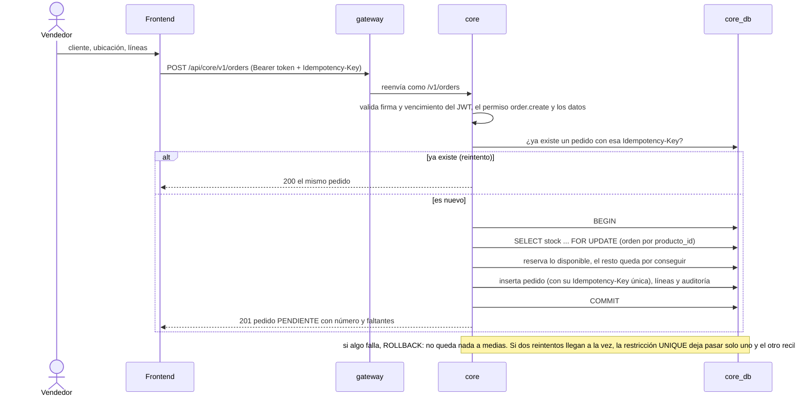

# Diseño técnico

Continúa la fase de **Diseño** del ciclo de vida (docs/00). docs/03 dice *qué* se guarda y qué reglas se cumplen; este documento dice *cómo* se construye.

## Ruta del diseño
| # | Parte | Estado | Se necesita en |
| --- | --- | --- | --- |
| D1 | Arquitectura (C4 niveles 1 y 2) y flujos principales | Hecho (31/10), diagramas probados | Semana 2 |
| D2 | Catálogo de permisos (código de permiso por caso de uso) | Hecho (31/10) | Semana 3 |
| D3 | Backlog: historias de usuario con criterios de aceptación (docs/07) | Hecho (31/10): detalle hasta la semana 3 | Semana 2 en adelante |
| D4 | Modelo físico de BD (ERD, claves, índices, constraints) por módulo | Pendiente | Semana 3 (auth), 4 (catálogo), 5 (stock), 6 (pedidos) |
| D5 | Contrato de API (endpoints por caso de uso) | Pendiente | Cada semana, con su capa |
| D6 | Bocetos de pantallas por perfil (celular primero para vendedores) | Pendiente | Cada semana, con su capa |
| D7 | Plan de pruebas (un test por regla de docs/03) | Pendiente | Semana 2, y crece cada semana |

D1–D3 son base y se hacen antes de programar. D4–D6 se diseñan justo antes de su capa (ADR-0002) para no rediseñar lo que aún puede cambiar.

---

## D1.1 Contexto (C4 nivel 1)
Quién usa el sistema y con qué sistemas externos convive.



- En el MVP **no hay integraciones automáticas**: la facturación y WhatsApp se usan a mano (ADR-0005).

## D1.2 Contenedores (C4 nivel 2), MVP
Qué procesos corren y cómo se hablan.



| Contenedor | Tecnología | Responsabilidad | Si se cae |
| --- | --- | --- | --- |
| gateway | Caddy | HTTPS automático, enruta por prefijo (quitándolo: core recibe `/v1/...`), sirve el frontend, límite de tamaño de petición, agrega `X-Request-ID` | Todo se detiene: es el punto crítico; se reinicia solo (`restart: unless-stopped`) |
| auth | Python + FastAPI | Login, refresh, logout, usuarios, perfiles, permisos; firma JWT con su **clave privada**; bloqueo temporal tras intentos fallidos de login | No se puede iniciar sesión ni refrescar, pero **los tokens vigentes siguen funcionando** en core (hasta 15 min) |
| core | Python + FastAPI | Todo el negocio de docs/03, PDFs y reportes; valida JWT con la **clave pública** | Se detienen pedidos y stock → contingencia en papel (UC-23) |
| PostgreSQL | PostgreSQL 18 | Una instancia con **una base por servicio** y un usuario por base, sin permisos sobre la base del otro | Todo se detiene → restauración con RTO 1 h |
| Monitor externo | Uptime Kuma en otra máquina o un servicio gratuito de monitoreo | Revisa `/api/auth/health/ready` y `/api/core/health/ready` y alerta al celular. Debe estar **fuera** del servidor: si estuviera dentro, se caería junto con lo que vigila | No afecta la operación |

Tamaño estimado del servidor: Caddy ~30 MB, auth ~100 MB, core ~250 MB (generación de PDF), PostgreSQL ~300–500 MB. Un servidor de **2 vCPU y 2–4 GB de RAM** alcanza con margen para el volumen de campaña.

Decisiones de este nivel:
- **Una base de datos por servicio** dentro de una sola instancia de PostgreSQL: aislamiento lógico (ningún servicio lee la base de otro) con el costo de un solo servidor. Se separan en instancias si crece.
- **El gateway no valida el JWT; lo valida cada servicio** con la clave pública de auth, que recibe como archivo (ADR-0007). core nunca llama a auth: por eso no hay flecha entre ellos y la caída de auth no detiene la operación (RNF-10).
- Rutas versionadas: `/api/auth/v1/...` y `/api/core/v1/...`. Como el gateway quita el prefijo, cada FastAPI se configura con `root_path` (`/api/auth`, `/api/core`) para que su documentación OpenAPI (`/docs`) funcione detrás del gateway.
- Cada servicio expone `GET /health` (el proceso está vivo) y `GET /health/ready` (además puede hablar con su base). Desde fuera: `/api/<servicio>/health/ready`.
- **Frontend y API en el mismo dominio** (el gateway sirve ambos): no hace falta CORS en producción y las cookies funcionan con `SameSite=Strict`. CORS solo se habilita en desarrollo, porque Vite corre en otro puerto.
- **Pedidos idempotentes**: el frontend genera un identificador único por pedido (`Idempotency-Key`). Si se corta la señal después de guardar y el vendedor reintenta, core devuelve el mismo pedido en vez de crear un duplicado (UC-16, 4b).

## D1.3 Seguridad: tokens y permisos
| Elemento | Decisión |
| --- | --- |
| Contraseñas | Hash con argon2 (RNF-02) |
| Access token | JWT firmado con RS256 (clave privada en auth), vida **15 min**. Lleva: `sub` (id de usuario), `name`, `perms` (lista de códigos de permiso), `iss` (emisor: auth), `aud` (destinatario: el sistema), `iat` y `exp`. Quien valida revisa firma, `iss`, `aud` y `exp` |
| Refresh token | Aleatorio, vida 7 días, guardado **hasheado** en auth_db, se **rota** en cada uso y se puede revocar (cerrar sesión, desactivar usuario). Si alguien usa un refresh ya rotado (posible robo), se revocan todas las sesiones de ese usuario |
| Dónde viven en el navegador | Access token en memoria (al recargar la página, el frontend pide uno nuevo con el refresh); refresh token en cookie `HttpOnly`, `Secure`, `SameSite=Strict`, con ruta `/api/auth/v1` (la usan refresh y logout). La ruta se fija explícitamente con el prefijo público, porque auth recibe las peticiones ya sin `/api/auth` |
| Fuerza bruta | auth bloquea el login de un usuario por 15 min tras 5 intentos fallidos seguidos; quien tenga `user.manage` puede desbloquearlo antes |
| Autorización | Cada endpoint de core declara el permiso que exige (ej. `order.create`) y lo compara con `perms` del token |
| Cambio de permisos | Se aplica en el siguiente refresh (máximo 15 min). Desactivar un usuario revoca sus refresh tokens |
| Datos del usuario en core | core no consulta a auth: copia `sub` y `name` del token en lo que registra (vendedor del pedido, auditoría). Es una foto del momento: si el usuario cambia de nombre, el historial conserva el anterior |
| Elegir usuarios desde core | core no tiene la lista de usuarios. Para asignar un repartidor (UC-22), el frontend pide a auth `GET /api/auth/v1/users?perm=dispatch.deliver` (solo id y nombre) y envía a core el id y el nombre elegidos; core los guarda como foto (`repartidor_id`, `repartidor_nombre`). El repartidor ve sus despachos porque su `sub` coincide con `repartidor_id`. Si auth está caído no se puede cambiar de repartidor, pero sí despachar con recojo en tienda |
| Cookies `Secure` | Solo viajan por HTTPS (en el navegador, `http://localhost` cuenta como seguro). Por eso staging necesita HTTPS desde su primer despliegue |
| Auditoría (RF-23) | Cada servicio audita lo suyo: auth los cambios de usuarios y permisos (UC-02), core las operaciones de negocio. UC-03 muestra la de core en el MVP; la vista unificada queda para después |

Trade-off aceptado: un permiso quitado puede seguir valiendo hasta 15 minutos. Para un equipo pequeño es razonable y evita una llamada a auth en cada petición.

## D1.4 Flujos principales

### Iniciar sesión (UC-01)


### Crear pedido (UC-16), el flujo crítico


## D1.5 Estructura del repositorio
```
/
├── services/
│   ├── auth/            app/ (api, domain, db), tests/, migrations/, Dockerfile, pyproject.toml
│   └── core/            app/ (catalog, stock, orders, dispatch, reports), tests/, migrations/, Dockerfile, pyproject.toml
├── libs/
│   └── security/        validación de JWT y permisos, compartida por auth y core (ADR-0007)
├── frontend/            Vite + React + TypeScript
├── infra/
│   ├── compose.yaml     servicios del MVP
│   ├── compose.dev.yaml ajustes para desarrollo local
│   ├── caddy/Caddyfile
│   └── backup/
├── docs/                este material (sin datos reales del negocio)
├── .github/workflows/   CI
├── .env.example         variables sin valores reales
└── CLAUDE.md
```
- Dentro de `core`, cada módulo (catalog, stock, orders, dispatch, reports) solo usa a otro por sus funciones públicas, nunca sus tablas directamente; así se puede separar en un servicio después (ADR-0003).
- `libs/security` es un paquete Python pequeño que auth y core instalan como dependencia local (uv). Es el único código compartido: nada de lógica de negocio en `libs/`.
- Por eso las imágenes Docker se construyen con **contexto en la raíz del repo** (`docker build -f services/core/Dockerfile .`): si el contexto fuera `services/core`, el Dockerfile no podría copiar `libs/security`. Un `.dockerignore` en la raíz evita enviar `node_modules`, `.venv`, `.git` y docs.
- Migraciones (Alembic): cada servicio tiene las suyas y se aplican como **paso del despliegue** (un contenedor de un solo uso que corre `alembic upgrade head` antes de levantar el servicio), no al arrancar la aplicación.

## D1.6 Configuración y secretos
- Todo lo que cambia por entorno va en variables de entorno (`DATABASE_URL` por servicio con el usuario de la aplicación, `MIGRATION_DATABASE_URL` por servicio con el usuario dueño del esquema (solo lo usa el contenedor de migraciones), `JWT_PRIVATE_KEY_PATH` (solo auth), `JWT_PUBLIC_KEY_PATH` (auth y core), `CORS_ORIGINS` (solo desarrollo)).
- Valores reales solo en `.env` (fuera de git); en el repo, `.env.example` con valores de ejemplo.
- Claves JWT generadas por entorno; nunca se suben. El `.env` y las claves de producción se guardan también fuera del servidor (si se pierden, hay que regenerarlas y todos vuelven a iniciar sesión).
- Fechas: se guardan como `timestamptz` (UTC) y se muestran en America/Lima.
- **Inmutabilidad garantizada por la base (RNF-05)**: el usuario de base con el que corre core **no tiene permiso de UPDATE ni DELETE** sobre `movimiento_stock` ni `auditoria` (solo INSERT y SELECT). Las migraciones usan otro usuario, el dueño del esquema, que también define con `ALTER DEFAULT PRIVILEGES` los permisos del usuario de la aplicación sobre las tablas nuevas (si no, cada tabla nueva quedaría sin acceso). Así, aunque el código tenga un error, el kardex y la auditoría no se pueden modificar.
- Contenedores con versión fija de imagen (nunca `latest`) y usuario no root.

## D1.7 Observabilidad mínima (MVP)
- Logs en JSON por la salida estándar, con `X-Request-ID` para seguir una petición del gateway a core.
- **Los logs nunca guardan** contraseñas, tokens, cookies ni datos personales de clientes (DNI/RUC, dirección, teléfono): se registran ids, no el contenido. El cuerpo de las peticiones no se escribe en el log.
- Health checks en Compose (`healthcheck`): sirven para arrancar en orden (`depends_on: condition: service_healthy`, core espera a PostgreSQL) y para ver el estado con `docker compose ps`. Ojo: Docker Compose **no reinicia** un contenedor marcado como *unhealthy*; `restart: unless-stopped` solo actúa si el proceso termina. Por eso el monitor externo es el que avisa.
- Monitor externo con alerta al celular (D1.2). Métricas y paneles (Prometheus, Grafana) después del MVP (capa 10).


## D1.8 Cobertura de requisitos no funcionales
| RNF | Cómo lo cumple el diseño | Dónde se comprueba |
| --- | --- | --- |
| RNF-01 Web responsive | Frontend celular primero en el mismo dominio que la API | T-13, HU-06, bocetos D6 |
| RNF-02 HTTPS, hash, JWT | Caddy con HTTPS, argon2, JWT RS256 de 15 min y refresh rotado | D1.3, HU-01 a HU-03, T-14 |
| RNF-03 Stock nunca negativo | `FOR UPDATE` en orden por producto + CHECK en la base | D1.4, docs/03 regla 11, tests de concurrencia (D7) |
| RNF-04 RPO ≤ 1 h | Archivado continuo de WAL + backup diario fuera del servidor | D1.2, T-16, T-17 |
| RNF-05 Kardex inmutable | La base niega UPDATE y DELETE al usuario de la aplicación | D1.6 |
| RNF-06 Respuesta < 1 s | Transacción corta, índices (D4), servidor dimensionado; PDF en una petición aparte | Medición en staging (T-14) y antes de producción |
| RNF-07 Todo con Docker Compose | `infra/compose.yaml` | T-06, T-07, T-12 |
| RNF-08 OpenAPI y tests | `/docs` de FastAPI detrás del gateway; un test por regla | D1.2, T-08, Definition of Done (docs/00), D7 |
| RNF-09 Español, PEN, Lima | Interfaz en español; montos `NUMERIC(12,2)`; fechas en UTC mostradas en America/Lima | D1.6 |
| RNF-10 Aislar fallas | core no depende de auth en tiempo de ejecución; servicios periféricos fuera del MVP | D1.2, ADR-0007 |
| RNF-11 RTO ≤ 1 h, horario | Reinicio automático, monitor externo, runbook para rehacer el servidor; mantenimientos de madrugada | D1.7, T-17, T-18 |
| RNF-12 Requiere conexión | Sin modo offline; pedidos idempotentes para conexiones inestables | D1.2 |
| RNF-13 Nube, costo mínimo | Un servidor de 2 vCPU y 2–4 GB; una instancia de PostgreSQL | D1.2 |
| RNF-14 Costos privados | Permiso `cost.view` solo para el dueño | D2 |

## D1.9 Datos personales
Los clientes y usuarios tienen datos personales (DNI/RUC, dirección, teléfono, correo); en Perú aplica la Ley 29733 de Protección de Datos Personales.
- Solo los ven quienes tienen permiso (D2); el repartidor ve solo los de sus despachos.
- Viajan cifrados (HTTPS) y los backups se guardan cifrados (D1.2).
- No salen en logs (D1.7) ni en el repo: staging y el portafolio usan solo **datos ficticios**.
- Se guarda solo lo necesario para vender y entregar (#37).


---

## D2 Catálogo de permisos
Cada acción exige **un permiso**; los perfiles de docs/01 son solo paquetes de permisos por defecto que el dueño puede ajustar por usuario (#33). Un usuario con varios perfiles tiene la unión de sus permisos. Códigos en inglés (convención del código), formato `recurso.acción`.

### Permisos
| Código | Qué permite | UC | Servicio |
| --- | --- | --- | --- |
| *(ninguno)* | Iniciar y cerrar sesión, ver su propio perfil | UC-01 | auth |
| `user.manage` | Crear, editar y desactivar usuarios; asignar perfiles y permisos | UC-02 | auth |
| `audit.view` | Consultar la auditoría | UC-03 | core |
| `catalog.manage` | Crear y editar productos, categorías, marcas, presentaciones y el stock mínimo por ubicación | UC-04 | core |
| `price.edit` | Crear y cambiar escalas de precio | UC-04 | core |
| `cost.view` | Ver y editar el costo de los productos (RNF-14) | UC-04, UC-10 | core |
| `catalog.import` | Importar productos desde Excel/CSV | UC-05 | core |
| `location.manage` | Crear y editar ubicaciones | UC-06 | core |
| `customer.manage` | Crear y editar clientes | UC-07 | core |
| `supplier.manage` | Crear y editar proveedores | UC-08 | core |
| `inventory.initial_load` | Cargar el inventario inicial de una ubicación | UC-09 | core |
| `stock.read` | Consultar stock, presentaciones y precios | UC-10 | core |
| `stock.receive` | Registrar ingresos de mercadería | UC-11 | core |
| `stock.transfer` | Transferir entre ubicaciones | UC-12 | core |
| `adjustment.request` | Proponer ajustes | UC-13 | core |
| `adjustment.approve` | Aprobar o rechazar ajustes | UC-14 | core |
| `kardex.read` | Consultar el kardex | UC-15 | core |
| `order.read` | Ver todos los pedidos, su estado y su nota de venta | UC-19, UC-27 | core |
| `order.create` | Crear pedidos | UC-16 | core |
| `order.update` | Modificar pedidos (agregar, quitar, cambiar cantidades) | UC-17 | core |
| `order.close_shortage` | Cerrar lo por conseguir (el cliente no espera), también al despachar | UC-17, UC-22 | core |
| `order.cancel` | Anular pedidos | UC-18 | core |
| `payment.register` | Registrar pagos | UC-20, UC-25 | core |
| `dispatch.prepare` | Ver la bandeja de pendientes y marcar en preparación | UC-21 | core |
| `dispatch.create` | Despachar (total o parcial), asignar repartidor, registrar nº de comprobante | UC-22 | core |
| `dispatch.register_late` | Registrar pedidos y despachos hechos en papel en una contingencia | UC-23 | core |
| `dispatch.deliver` | Marcar en camino y registrar la entrega con rechazos | UC-24, UC-25 | core |
| `report.view` | Ver reportes (stock, stock bajo, ventas, por conseguir, pedidos por estado) | UC-26, UC-27, UC-28, UC-30 | core |
| `report.export` | Exportar reportes a Excel o PDF | UC-29 | core |

### Perfiles por defecto
✅ = incluido. Fuente: docs/01 (perfiles) y la entrevista (#33, #63, #64, #65, #69).

| Permiso | Dueño | Vendedor | Almacén | Repartidor |
| --- | :-: | :-: | :-: | :-: |
| `user.manage` | ✅ | | | |
| `audit.view` | ✅ | | | |
| `catalog.manage` | ✅ | | | |
| `price.edit` | ✅ | | | |
| `cost.view` | ✅ | | | |
| `catalog.import` | ✅ | | | |
| `location.manage` | ✅ | | | |
| `customer.manage` | ✅ | ✅ | | |
| `supplier.manage` | ✅ | | | |
| `inventory.initial_load` | ✅ | | | |
| `stock.read` | ✅ | ✅ | ✅ | ✅ |
| `stock.receive` | ✅ | | ✅ | |
| `stock.transfer` | ✅ | | ✅ | |
| `adjustment.request` | ✅ | | ✅ | |
| `adjustment.approve` | ✅ | | | |
| `kardex.read` | ✅ | | ✅ | |
| `order.read` | ✅ | ✅ | ✅ | |
| `order.create` | ✅ | ✅ | | |
| `order.update` | ✅ | ✅ | | |
| `order.close_shortage` | ✅ | ✅ | | |
| `order.cancel` | ✅ | ✅ | | |
| `payment.register` | ✅ | ✅ | | ✅ |
| `dispatch.prepare` | ✅ | | ✅ | |
| `dispatch.create` | ✅ | | ✅ | |
| `dispatch.register_late` | ✅ | | ✅ | |
| `dispatch.deliver` | ✅ | | | ✅ |
| `report.view` | ✅ | | | |
| `report.export` | ✅ | | | |

### Reglas de alcance (además del permiso)
| Regla | Detalle |
| --- | --- |
| Despachos del repartidor | Con `dispatch.deliver` y sin `dispatch.prepare`, el usuario solo ve los despachos **asignados a él**, con los datos del cliente necesarios para entregar. |
| Estados que permiten actuar | El permiso no salta las reglas de docs/03: por ejemplo, `order.cancel` solo funciona antes de ENTREGADO (regla 9) y `dispatch.create` solo sobre lo reservado (regla 7). |
| Pagos al entregar | El repartidor registra pagos solo de los pedidos de sus despachos. |
| Lecturas de apoyo | Las listas que se necesitan para operar (ubicaciones, categorías) solo requieren sesión iniciada. Con `stock.receive` se puede listar proveedores (solo lectura) para registrar un ingreso. Con `order.read` o `dispatch.prepare` se ven los datos del cliente de cada pedido. Con `dispatch.create` se puede listar en auth a los usuarios que tienen `dispatch.deliver` (solo id y nombre), para asignar repartidor. |
| Último administrador | No se puede quitar `user.manage` al último usuario activo que lo tiene (evita quedarse sin administrador). |
| Validación | Cada endpoint declara su permiso; el frontend oculta botones sin permiso, pero **la regla la aplica el backend** (el frontend nunca es la seguridad). |

Hallazgo de esta revisión (**H-10**): en UC-22 (2c) quien despacha puede "cerrar el resto", pero la regla 17 de docs/03 dice que eso lo decide el vendedor o el dueño. Se resuelve con el permiso `order.close_shortage`: por defecto lo tienen Vendedor y Dueño, y el dueño puede dárselo a quien despacha si lo necesita.

## Pendientes de diseño de esta parte
- Elegir el proveedor cloud, el almacenamiento de backups y el **dominio** (antes de la semana 5: staging necesita HTTPS, y HTTPS necesita un dominio o subdominio).
- El servidor es un punto único de falla: para cumplir el RTO de 1 h hace falta un procedimiento escrito y probado para levantar un servidor nuevo desde el repo y el último backup (runbook, semana 8).
- El repo es público: revisar que docs/01–05 no tengan datos reales del negocio antes del primer push.
