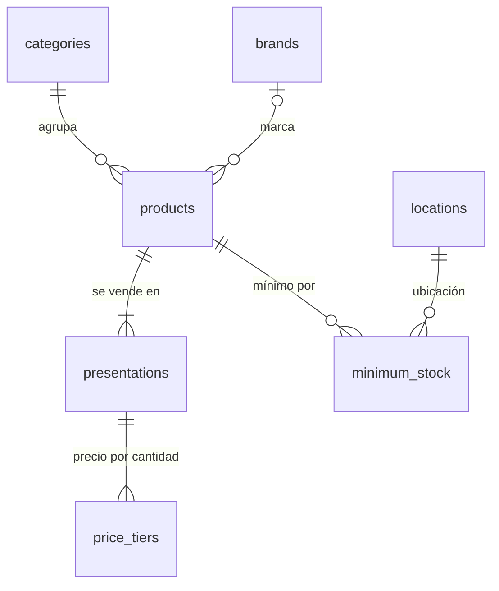

# Modelo físico de la base de datos (D4)

Parte D4 del diseño (docs/06): tablas reales, claves, restricciones e índices de cada módulo. Se diseña **justo antes** de construir cada capa (ADR-0002). docs/03 dice *qué* se guarda y qué reglas se cumplen; este documento dice *cómo* queda en PostgreSQL.

| Módulo | Base | Estado |
| --- | --- | --- |
| auth: usuarios, perfiles, permisos y sesiones | `auth_db` | Hecho (22/11): ver docs/codigo/auth.md |
| **catálogo**: productos, presentaciones, precios, ubicaciones, clientes, proveedores, auditoría | `core_db` | **Diseño del 25/11 (este documento)** |
| stock y kardex | `core_db` | Semana 5 |
| pedidos y pagos | `core_db` | Semana 6 |
| despachos | `core_db` | Semana 7 |

## Convenciones de todas las tablas
- **Nombres en inglés** (convención del código); la tabla de equivalencias con docs/03 está al final.
- Claves primarias `bigint GENERATED ALWAYS AS IDENTITY` en el catálogo: números cortos y legibles, y el orden de bloqueo "por `product_id`" de la regla 11 es natural. (auth usa UUID porque sus ids viajan en tokens.)
- Montos `NUMERIC(12,2)`, nunca `float`. Cantidades `integer` en unidad base.
- Fechas `timestamptz` (UTC; se muestran en America/Lima).
- Textos únicos sin importar mayúsculas: índice único sobre `lower(...)` (ej. no pueden existir "Escritura" y "escritura").
- Nada se borra: los registros se **desactivan** (`active = false`). Así los pedidos viejos siguen apuntando a productos válidos.
- Las reglas que la base puede garantizar se escriben como `CHECK` o `UNIQUE`, además de validarse en el código: si el código tiene un error, la base igual las cumple.

## Catálogo (semana 4)

`customers`, `suppliers` y `audit_log` no tienen relaciones dentro del catálogo; las usan pedidos, ingresos y todos los módulos, respectivamente.

### Tablas
| Tabla | Columnas | Restricciones e índices |
| --- | --- | --- |
| `categories` | `id`, `name` varchar(60), `active` | Único `lower(name)` |
| `brands` | `id`, `name` varchar(60), `active` | Único `lower(name)` |
| `products` | `id`, `sku` varchar(40), `barcode` varchar(32) NULL, `name` varchar(200), `category_id` → categories, `brand_id` → brands NULL, `base_unit` varchar(20), `cost` NUMERIC(12,2) NULL, `active`, `created_at`, `updated_at` | Único `lower(sku)`; único `barcode` cuando no es NULL; `cost >= 0`; `base_unit = upper(base_unit)`; índice en `category_id`; índice para buscar por nombre (`lower(name)` con `text_pattern_ops`) |
| `presentations` | `id`, `product_id` → products, `name` varchar(30), `factor` integer, `barcode` varchar(32) NULL, `active` | `factor >= 1`; único (`product_id`, `name`); único `barcode` cuando no es NULL; `name = upper(name)` |
| `price_tiers` | `id`, `presentation_id` → presentations, `min_quantity` integer, `price` NUMERIC(12,2) | `min_quantity >= 1`; `price > 0`; único (`presentation_id`, `min_quantity`) |
| `locations` | `id`, `name` varchar(60), `type` varchar(10), `address` varchar(200) NULL, `active` | Único `lower(name)`; `type IN ('STORE', 'WAREHOUSE')` |
| `minimum_stock` | `product_id` → products, `location_id` → locations, `quantity` integer | PK (`product_id`, `location_id`); `quantity >= 0` |
| `customers` | `id`, `document_type` varchar(3) NULL, `document_number` varchar(15) NULL, `name` varchar(200), `address` varchar(250) NULL, `phone` varchar(20) NULL, `active`, `created_at` | `document_type IN ('DNI', 'RUC', 'CE')`; tipo y número van juntos (los dos o ninguno); único (`document_type`, `document_number`); DNI = 8 dígitos, RUC = 11 dígitos; índice para buscar por nombre |
| `suppliers` | `id`, `ruc` char(11), `business_name` varchar(200), `contact` varchar(120) NULL, `phone` varchar(20) NULL, `active` | Único `ruc`; `ruc` de 11 dígitos |
| `audit_log` | `id`, `occurred_at`, `user_id`, `user_name`, `action` varchar(40), `entity` varchar(40), `entity_id` varchar(40), `before` jsonb NULL, `after` jsonb NULL | Índices en (`entity`, `entity_id`) y en `occurred_at`. **`core_app` solo puede INSERT y SELECT** (RNF-05): se le quitan UPDATE y DELETE en la misma migración |

### Reglas del catálogo (además de las restricciones)
| Regla | Dónde se cumple |
| --- | --- |
| Al crear un producto se crea **sola** su presentación base (nombre = unidad base, factor 1). Sin ella no se podría vender por unidad | Servicio |
| La presentación base (factor 1) no se puede desactivar mientras el producto esté activo | Servicio |
| Una presentación solo se puede vender si tiene precio **desde 1** (regla 6 de docs/03: siempre hay una escala que aplica) | Servicio de pedidos (semana 6); la importación lo exige |
| El factor de una presentación **no cambia** una vez creada: los pedidos guardan su propio factor congelado, pero cambiarlo confundiría el stock mostrado. Si hay un error, se desactiva y se crea otra | Servicio |
| El **costo** solo se ve y se cambia con `cost.view` (regla 15, RNF-14). Sin ese permiso, la API no lo devuelve; enviarlo da 403 | API |
| Cambios de precio y de costo, y altas o bajas de productos, quedan en `audit_log` con quién, cuándo, antes y después (RF-23) | Servicio, en la misma transacción |
| `user_id` y `user_name` de la auditoría salen del token: core no consulta a auth (docs/06 D1.3) | Servicio |

### API del catálogo (`/api/core/v1/...`)
| Endpoint | Permiso |
| --- | --- |
| `GET /categories`, `GET /brands`, `GET /locations` | Sesión iniciada (lecturas de apoyo, docs/06 D2) |
| `POST`, `PATCH` de categorías y marcas | `catalog.manage` |
| `POST`, `PATCH /locations` | `location.manage` |
| `GET /products` (búsqueda por nombre, SKU o código de barras; filtros por categoría y activo; paginado) y `GET /products/{id}` (con presentaciones y precios) | `stock.read` |
| `POST /products`, `PATCH /products/{id}`, presentaciones, stock mínimo | `catalog.manage` (y `cost.view` si incluye el costo) |
| `PUT /presentations/{id}/price-tiers` (reemplaza las escalas de una presentación) | `price.edit` |
| `POST /catalog/import` con la plantilla (`dry_run=true` solo valida y devuelve el reporte de errores por fila) | `catalog.import` |
| `GET`, `POST`, `PATCH /customers` | `customer.manage` |
| `GET /suppliers` | `supplier.manage` o `stock.receive` |
| `POST`, `PATCH /suppliers` | `supplier.manage` |

Cada endpoint protegido tiene tests de 401 (sin token) y 403 (sin permiso) (convención de CLAUDE.md).

### Decisiones de este diseño
| Decisión | Por qué |
| --- | --- |
| Marcas en su propia tabla (no texto libre en el producto) | RF-02 pide gestionarlas; evita "Faber", "faber" y "Faber " como marcas distintas, y permite filtrar |
| Stock mínimo en su propia tabla `minimum_stock`, del módulo catálogo, y no como columna de `stock` (docs/03) | El mínimo es configuración (catálogo) y el stock son cantidades (módulo stock, semana 5): así cada módulo es dueño de sus tablas (ADR-0003). Además, configurar un mínimo no obliga a crear filas de stock en 0 |
| Clientes con documento **opcional** | Confirmado el 25/11: un pedido no necesita DNI ni RUC; puede usarse un cliente genérico (ej. "Clientes varios"). Cuándo pedir documento lo decide el dueño al capacitar a su equipo: el sistema no lo impone. Si se registra, se valida (DNI 8 dígitos, RUC 11) y no se repite |

### Preguntas para el dueño (no se inventan datos del negocio)
- ¿El **costo** de la plantilla incluye IGV?

## Equivalencias con docs/03
| docs/03 | Tabla |
| --- | --- |
| categoria / marca | `categories` / `brands` |
| producto | `products` |
| presentacion | `presentations` |
| precio_escala | `price_tiers` |
| ubicacion (TIENDA, ALMACEN) | `locations` (STORE, WAREHOUSE) |
| stock.stock_minimo | `minimum_stock` |
| cliente / proveedor | `customers` / `suppliers` |
| auditoria | `audit_log` |
